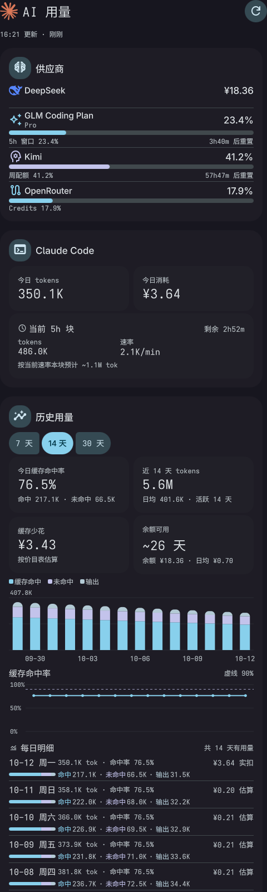
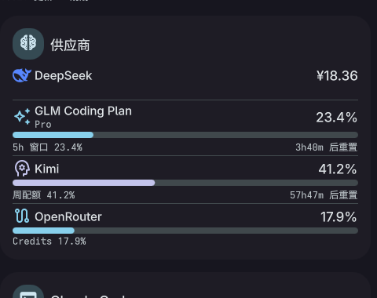
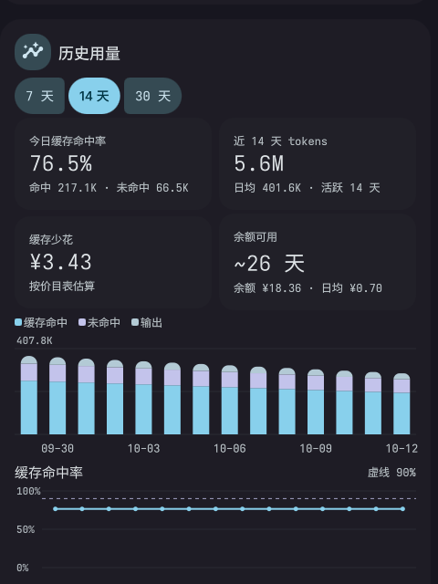

# clavis-ai-usage

> [Clavis Shell](https://github.com/StatIndet/quickshell)（niri + Quickshell）侧边栏的 **AI 用量看板**：
> 聚合 DeepSeek / GLM / Kimi / OpenRouter 的余额与配额、Claude Code 本地 token 用量与花费，
> 一页看清所有 AI 开销。

<p align="center">
  
</p>

<p align="center">
  
  
</p>

## 功能

- **多供应商**：余额/配额进度条、重置倒计时（数据来自 [ai-usagebar](https://github.com/akitaonrails/ai-usagebar)）
- **Claude Code 本地用量**：今日 token 与费用、当前 5h 计费块速率（数据来自 [ccusage](https://github.com/ryoppippi/ccusage)）
- **历史用量**：每日堆叠柱状图 + 缓存命中率折线（7/14/30 天切换），180 天本地历史
- **可选数据源**：New-API 中转站额度；DeepSeek 平台账单（非公开接口，默认关闭，见 [docs/CONFIGURATION.md](docs/CONFIGURATION.md)）
- 明暗主题跟随 Clavis；侧边栏第 4 页 + 顶栏快捷按钮

## 依赖

| 依赖 | 必需性 | 说明 |
|---|---|---|
| Clavis Shell（Quickshell） | 必需 | 本组件是它的 overlay 扩展 |
| `bash` `jq` `curl` `python3` | 必需 | 后端脚本与安装器 |
| [`ai-usagebar`](https://github.com/akitaonrails/ai-usagebar) | 推荐（AUR: `ai-usagebar`） | 供应商余额/配额来源 |
| [`ccusage`](https://github.com/ryoppippi/ccusage) | 可选 | Claude Code 本地用量来源 |
| `rsync` | 可选 | overlay 同步更快 |

## 安装

```bash
git clone https://github.com/<owner>/clavis-ai-usage.git
cd clavis-ai-usage
./install.sh --dry-run   # 先看会发生什么（不写任何文件、不停 shell）
./install.sh             # 正式安装（自动停/起 clavis-shell）
```

安装采用 **overlay** 方式：把 `Clavis 源码树` 镜像到 `~/.config/quickshell/clavis/` 再叠加补丁，
**不触碰 `/etc`**（那是包管理器的地盘，升级会被覆盖）。

Clavis 升级后：

```bash
./install.sh --sync      # 重新对齐（失败会保留旧 overlay 并恢复运行，不会炸）
./install.sh --verify    # 随时检查：overlay 是否陈旧 / 文件是否被改动
./install.sh --uninstall # 卸载（默认保留你的配置与缓存）
```

> ⚠️ Clavis 尚无插件系统，本组件通过"锚点补丁"接入，Clavis 大版本升级后锚点可能漂移
> ——`--sync` 会明确报错并给出修复指引，见 [docs/COMPATIBILITY.md](docs/COMPATIBILITY.md)。

## 配置

配置文件：`~/.config/clavis-ai-usage/config.json`（首次安装会从旧路径自动迁移，权限 0600）。
详见 [docs/CONFIGURATION.md](docs/CONFIGURATION.md)。

## 免责声明

- 本项目**与 Anthropic、DeepSeek 均无关联**；"Claude""DeepSeek" 相关名称与图标为各自权利人的商标。
- "DeepSeek 平台账单"功能使用其网站的非公开接口，可能随时失效，风险自担，**默认关闭**。
- 本项目按 GPL-3.0-or-later 发布（见 [LICENSE](LICENSE)、[NOTICE](NOTICE)）。

## 文档

| 文档 | 内容 |
|---|---|
| [docs/ARCHITECTURE.md](docs/ARCHITECTURE.md) | 数据流、JSON 契约（`schema_version: 1`） |
| [docs/CONFIGURATION.md](docs/CONFIGURATION.md) | 全部配置项与凭据说明 |
| [docs/COMPATIBILITY.md](docs/COMPATIBILITY.md) | Clavis 版本兼容表与锚点漂移处理 |
| [docs/TROUBLESHOOTING.md](docs/TROUBLESHOOTING.md) | 常见问题 |
